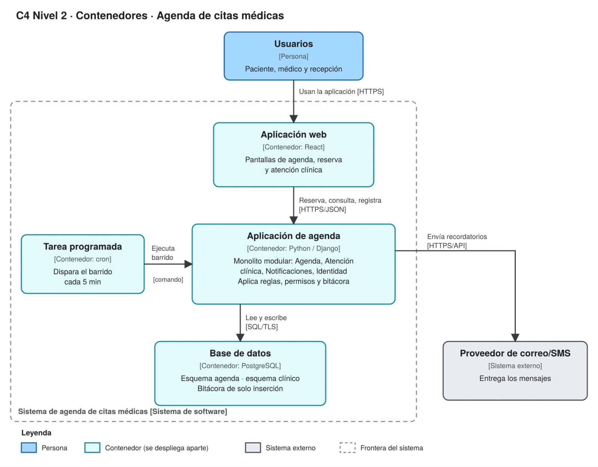

# Agenda de citas médicas · Esqueleto caminante

Monolito modular para una clínica: sin dobles reservas y con la historia clínica protegida.
Grupo 5B · Juan Camilo Parra Sánchez · Juan Diego López Arias · Jeferson Manuel Morillo Vallejo · UCC Pasto

Es la implementación más delgada que atraviesa el sistema de punta a punta y materializa las decisiones del
informe de arquitectura: **un solo proceso Django con cuatro módulos** (Agenda, Atención clínica,
Notificaciones, Identidad y acceso), **una base PostgreSQL con un esquema por módulo** y una **tarea
programada** que dispara el barrido cada 5 min.

## Arrancar (un comando)

Requisito: Docker Desktop (o Docker Engine con Compose v2).

```sh
docker compose up --build
```

| Qué | Dónde |
|---|---|
| Aplicación web (React) | http://localhost:8080 · también https://localhost:8443 (certificado autofirmado) |
| Chequeo de salud | http://localhost:8080/salud |
| Proveedor de correo/SMS simulado (lo que "llega" al paciente) | http://localhost:8025 |

Usuarios de demostración (clave de todos: `demo1234`):

| Usuario | Rol | Para qué sirve en la demo |
|---|---|---|
| `ana` | Paciente | Ya tiene una cita con la Dra. Rojas, así que existe la relación de tratamiento |
| `bruno` | Paciente | Segundo paciente |
| `dra.rojas` | Médica | Médica tratante de Ana: puede ver y registrar su historia |
| `dr.mora` | Médico | **Sin** relación con Ana: se le deniega y queda en la bitácora (S-1) |
| `recepcion` | Recepción | Define horarios, abre cupos y genera el reporte mensual; no ve datos clínicos (S-2) |

Para apagar: `docker compose down` (agregue `-v` para borrar también los datos).

## Correspondencia con el diseño

### C4 Nivel 2 → servicios de `docker-compose.yml`



| Contenedor del diagrama | Servicio | Código |
|---|---|---|
| Aplicación web [React] | `aplicacion-web` (nginx sirve la SPA y reenvía `/api` por HTTPS/JSON) | `web/` |
| Aplicación de agenda [Python / Django], monolito modular | `aplicacion-agenda` (**un** proceso gunicorn) | `app/` |
| Tarea programada [cron]: "Ejecuta barrido [comando]" cada 5 min | `tarea-programada` (cron ejecuta `python manage.py barrido`) | `app/tarea/`, `app/config/management/commands/barrido.py` |
| Base de datos [PostgreSQL]: esquema agenda · esquema clínico · bitácora de solo inserción, conexión SQL/TLS | `base-de-datos` (TLS activo, `sslmode=require`) | `db/Dockerfile`, `app/*/migrations/` |
| Proveedor de correo/SMS [Sistema externo] | `proveedor-correo-sms`: **simulado**, fuera de la frontera del sistema | `proveedor-simulado/` |

"Un proceso, no tres": los cuatro módulos corren dentro de `aplicacion-agenda`. No hay servicios por módulo.

### Contextos delimitados → módulos (`app/`)

Cada módulo es una app de Django con **sus propias tablas en su propio esquema** y una interfaz pública
`api.py`, que es lo único que los demás pueden importar. Se refieren entre sí por identificador
(`paciente_id`, `cita_id`), nunca con llaves foráneas entre esquemas.

| Módulo | Esquema | Responsabilidad |
|---|---|---|
| `agenda` | `agenda` | Cupos, citas, reglas de 24 h y 15 min. Publica los eventos de cita |
| `atencion_clinica` | `clinico` | Diagnósticos, recetas, relación de tratamiento y bitácora. Ningún otro módulo lee este esquema |
| `notificaciones` | `notificaciones` | Plantillas, canales y envíos |
| `identidad` | `identidad` | Usuarios, roles y sesiones. Todos verifican la sesión aquí |

Atención clínica arma su propia relación de tratamiento a partir del evento `CitaReservada`, así que no le
pregunta a Agenda en cada lectura. Notificaciones reacciona a los eventos de cita. Los eventos van **en
proceso**, sin broker (ADR-001), y sus manejadores corren dentro de la transacción de la reserva.

Capas dentro de cada módulo: `vistas.py`/`urls.py` (presentación) → `aplicacion.py` (casos de uso) →
`dominio.py` (reglas puras, sin Django) y `models.py`/`canales.py`/`cifrado.py` (infraestructura).

### Tácticas → código

| Táctica | Escenario | Dónde |
|---|---|---|
| Escritura condicional `UPDATE cupo … WHERE estado='LIBRE'` en una transacción | E-1 | `agenda/aplicacion.py` `_tomar_cupo`, `reservar` |
| Índice único: una sola cita vigente por cupo | E-1 | `agenda/models.py` `una_cita_vigente_por_cupo` |
| Idempotencia: clave única por solicitud (`Idempotency-Key`) | E-1, C-2 | `agenda/models.py` `SolicitudReserva`, `web/src/paginas/Paciente.jsx` |
| Autorizar por rol **y** relación de tratamiento | E-2 | `atencion_clinica/aplicacion.py` `_autorizar` |
| Auditar: bitácora de solo inserción (un disparador rechaza UPDATE y DELETE) | E-2 | `atencion_clinica/migrations/0003_solo_insercion.py` |
| Cifrar: TLS y cifrado en reposo de diagnóstico y receta (Fernet) | E-2 | `atencion_clinica/cifrado.py`, `db/Dockerfile`, `web/tls.sh` |
| Registros clínicos que no se borran, se versionan (R-3) | — | `RegistroClinico.version` + disparador |
| Latido `/salud` y reinicio automático | E-3 | `config/vistas.py`, `app/salud.py`, `healthcheck` + `restart: always` |
| Barrido idempotente cada 5 min con cambios de estado condicionales | E-4 | `agenda/models.py` `marcar_inasistencias`, `marcar_recordatorios` |
| Degradación elegante: si falla el correo/SMS la reserva se confirma y el envío se reintenta | D-2 | `notificaciones/aplicacion.py` |
| Cambiar de canal sin tocar Agenda | M-1 | `notificaciones/canales.py` (`NOTIFICACIONES_CANAL`) |
| Alerta si el último barrido tiene más de 15 min | RS-3 | `config/vistas.py` (`barrido_atrasado`), aviso en la pantalla de Recepción |

## Pruebas automáticas

```sh
docker compose run --rm aplicacion-agenda python manage.py test
```

| Archivo | Qué verifica |
|---|---|
| `tests/test_fronteras.py` | **Función de aptitud de ADR-001**: falla si un módulo importa algo distinto de `<otro>.api` (por ejemplo, sus modelos), si escribe SQL contra el esquema de otro o si una capa depende hacia arriba |
| `tests/test_reserva.py` | 30 hilos sobre el mismo cupo confirman exactamente una cita (C-1); doble clic con la misma clave crea una sola (C-2); alternativas; índice único; reprogramar |
| `tests/test_clinica.py` | Médico sin relación denegado y registrado en el 100 % de los intentos (S-1); Recepción sin datos clínicos (S-2); la denegación no revela si hay registros; bitácora inmodificable; cifrado en reposo; versionado |
| `tests/test_barrido.py` | Inasistencia una sola vez aunque el barrido corra dos veces; registro ≤ 20 min; recordatorio 24 h antes, sin duplicados (T-1, T-2) |
| `tests/test_notificaciones.py` | Proveedor caído: la reserva se confirma y el envío queda pendiente; al volver se reintenta (D-2); el proveedor nunca recibe datos clínicos; cambio de canal (M-1) |

## Escenarios contra el sistema desplegado (demostración en vivo)

Con el sistema arriba, desde la raíz del repositorio (Python 3, sin dependencias):

| Escenario | Comando | Medida |
|---|---|---|
| E-1 · Reservas simultáneas | `python escenarios/e1_reservas_simultaneas.py` | 0 dobles reservas en 100 repeticiones de 30 solicitudes; p95 ≤ 1 s |
| E-2 · Lectura clínica sin relación | En la web: `dr.mora` → Atención clínica → Ana → Ver historia. Luego `docker compose exec aplicacion-agenda python manage.py ver_bitacora` | Denegado y registrado (quién, qué, cuándo) |
| E-3 · Caída del proceso | `python escenarios/e3_caida.py` (el proceso termina) o `python escenarios/e3_caida.py --congelar` (deja de responder) | Recuperación ≤ 2 min; 0 citas confirmadas perdidas |
| E-4 · Inasistencia tras un reinicio | `python escenarios/e4_inasistencia.py` | Se marca una sola vez; 1 notificación sin duplicados |
| P-1 · 80 usuarios consultando disponibilidad | `python escenarios/p1_carga.py` | p95 ≤ 1 s |
| D-2 · Cae el proveedor de correo/SMS | `docker compose stop proveedor-correo-sms`, reservar en la web (la notificación queda PENDIENTE), `docker compose start proveedor-correo-sms` y `docker compose exec tarea-programada python manage.py barrido` | Se sigue agendando; el envío sale al volver |
| RS-3 · La tarea programada se detiene | `docker compose stop tarea-programada` y esperar 15 min: `/salud` marca `barrido_atrasado` y Recepción ve la alerta | Salta una alerta |

Resultados obtenidos en una máquina de desarrollo:

| Escenario | Resultado |
|---|---|
| E-1 | 3000 solicitudes, **0 dobles reservas**, p95 = 0,27 s |
| E-3 (termina) | recuperación en 4 s, 0 citas perdidas |
| E-3 (congelado) | detectado por `/salud` y recuperado en 43 s, 0 citas perdidas |
| E-4 | barrido 1: 1 inasistencia; barrido 2: 0; 1 sola notificación |
| P-1 | 80 usuarios, p95 = 0,08 s, 0 errores |

## API (resumen)

Todas las rutas, salvo el inicio de sesión y `/salud`, exigen `Authorization: Bearer <token>`.

| Método y ruta | Rol | Qué hace |
|---|---|---|
| `POST /api/identidad/sesiones` | — | Inicia sesión `{usuario, clave}` → `{token, usuario}` |
| `GET /api/identidad/medicos` · `GET /api/identidad/pacientes` | todos · médico/recepción | Listados |
| `GET /api/agenda/cupos?medico_id=` | todos | Cupos libres |
| `POST /api/agenda/citas` + `Idempotency-Key` | paciente | Reserva `{cupo_id}`: 201 nueva · 200 reintento · 409 "Cupo ya tomado" con alternativas |
| `GET /api/agenda/citas` | todos | Las del paciente, las del médico o todas (recepción) |
| `POST /api/agenda/citas/{id}/cancelar` · `/reprogramar` · `/asistencia` | paciente/recepción · paciente · médico | Cambios de estado |
| `POST /api/agenda/horarios` | recepción | Abre cupos `{medico_id, fecha, hora_inicio, hora_fin, duracion_minutos}` |
| `GET /api/agenda/reportes/mensual?mes=AAAA-MM` | recepción | Reporte mensual (P-2) |
| `GET /api/clinica/pacientes/{id}/historia` · `POST …/atenciones` | médico tratante | Historia clínica; cualquier otro recibe 403 y queda en la bitácora |
| `GET /api/notificaciones/mias` | paciente | Estado de sus envíos |
| `GET /salud` | — | Latido: base de datos y antigüedad del último barrido |

## Estructura

```
docker-compose.yml        un comando: los contenedores del C4 Nivel 2
db/                       PostgreSQL con TLS
app/                      Aplicación de agenda (Django): un proceso, cuatro módulos
  config/                 raíz de composición: settings, /salud, comandos barrido y sembrar
  identidad/ agenda/ atencion_clinica/ notificaciones/
      api.py              interfaz pública (lo único importable desde otro módulo)
      dominio.py          reglas puras
      aplicacion.py       casos de uso
      models.py ...       infraestructura (tablas en el esquema del módulo)
      vistas.py urls.py   presentación HTTP/JSON
  tarea/                  crontab y arranque del contenedor Tarea programada
  tests/                  pruebas automáticas y funciones de aptitud
web/                      Aplicación web (React + Vite, servida por nginx)
proveedor-simulado/       sistema externo simulado (correo/SMS)
escenarios/               scripts que miden E-1, E-3, E-4 y P-1 contra el sistema desplegado
docs/diagramas/           árbol de utilidad y diagramas C4
```

## Configuración

Las variables están en `docker-compose.yml` (`x-entorno-agenda`). Los valores incluidos son **solo
para desarrollo**: en producción cambie `POSTGRES_PASSWORD`, `DJANGO_SECRET_KEY` y
`CLAVE_CIFRADO_CLINICO`, y confirme que la base se aloja en Colombia (riesgo RS-1, R-2).
