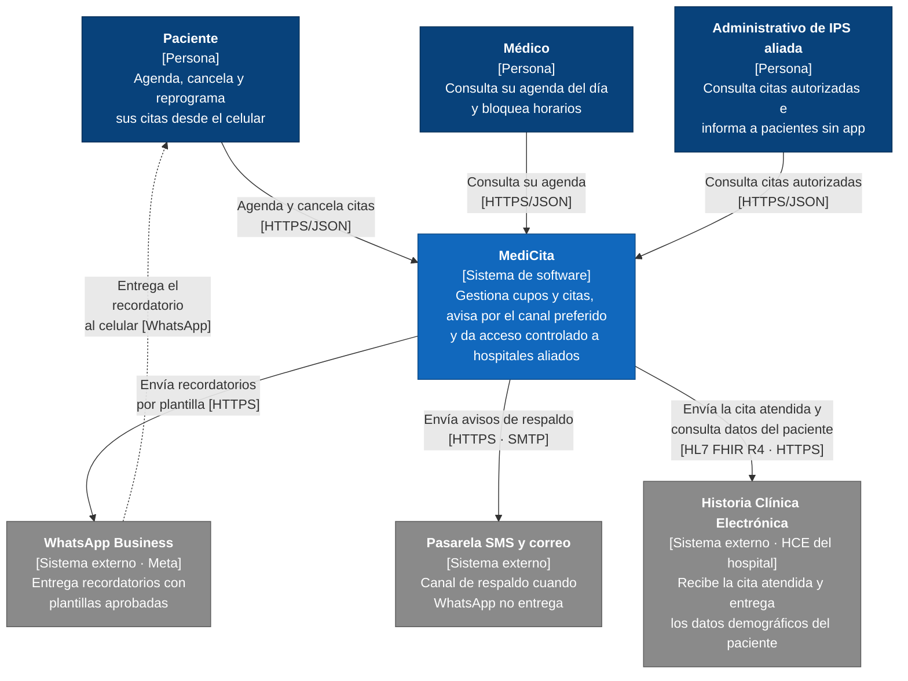
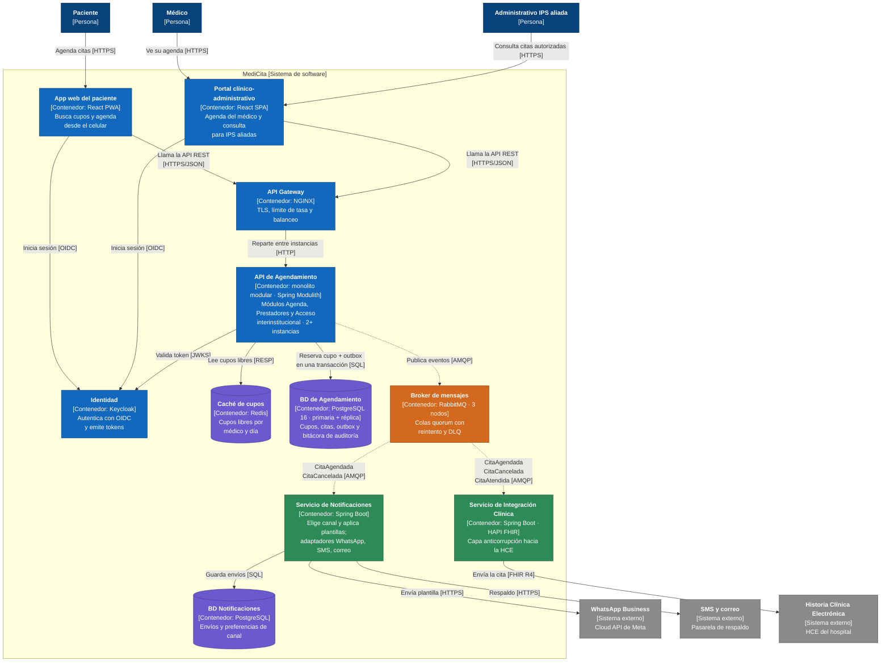

# MediCita — Arquitectura del agendador de citas médicas

Proyecto integrador · Arquitectura de software · Momento evaluativo 3 · UCC Pasto · Noviembre 2026

> Agendador de citas médicas siempre disponible, conectado a la historia clínica y con avisos por WhatsApp.

Este documento reproduce el texto de la sustentación. Cada sección termina con una línea **En el esqueleto** que indica dónde se materializa en este repositorio. Las decisiones están registradas en [ADR-001](adr/ADR-001-estilo-arquitectonico.md), [ADR-002](adr/ADR-002-mensajeria-outbox-rabbitmq.md) y [ADR-003](adr/ADR-003-canales-notificacion.md).

---

## 1. Contexto: el sistema

MediCita permite a los **pacientes** agendar, cancelar y reprogramar citas; a los **médicos**, gestionar su agenda; y al **personal administrativo de hospitales aliados**, consultar citas para informar a quien no puede usar el celular.

### Usuarios

| Usuario | Qué necesita |
|---|---|
| Paciente | Quiere un cupo rápido, sin filas ni llamadas, y que le recuerden la cita. |
| Médico | Necesita ver su día en una pantalla y bloquear horarios sin pedirle a nadie. |
| Administrativo IPS aliada | Consulta citas de pacientes que lo autorizaron y les informa en ventanilla o por teléfono. |

Ideas fuerza: siempre disponible · fácil para pacientes y médicos · rol administrativo interinstitucional · conexión con historia clínica · avisos por WhatsApp y más canales.

### Reglas de negocio

- Un cupo pertenece a una sola cita; nunca se asigna dos veces.
- El cupo se retiene 5 min mientras el paciente confirma.
- Cancelar sin penalidad hasta 24 h antes (valor configurable por sede).
- Una IPS aliada sólo ve citas de pacientes con consentimiento vigente.

### Restricciones externas

- **Ley 1581 de 2012:** los datos de salud son sensibles; exigen autorización y trazabilidad.
- **Ley 2015 de 2020 y Res. 866 de 2021:** historia clínica electrónica interoperable (HL7 FHIR).
- **WhatsApp Business:** fuera de la ventana de 24 h sólo se envían plantillas aprobadas por Meta.

**En el esqueleto:** las reglas viven en el módulo `agenda` (cupo único, retención de 5 min, política de cancelación por sede en `agenda.politica_cancelacion`) y en `acceso` (consentimiento vigente) de `servicios/agendamiento/`; los usuarios demo están en `infra/keycloak/medicita-realm.json` (ver el README).

---

## 2. Drivers arquitectónicos

Ordenados por importancia para el negocio. Cada uno lleva su marca (importancia para el negocio, dificultad técnica): A = alta · M = media · B = baja.

| # | Driver | Por qué | Atributo | Marca |
|---|---|---|---|---|
| 1 | Agendamiento siempre disponible | Si no se puede agendar, el paciente pierde su cupo y el hospital su ingreso; el cliente lo exigió explícitamente. | Disponibilidad | (A, A) |
| 2 | Ningún cupo asignado dos veces | En la apertura de agendas miles de pacientes compiten por los mismos cupos; un doble agendamiento termina en conflicto en el consultorio. | Escalabilidad | (A, A) |
| 3 | Acceso interinstitucional seguro | Personal de otros hospitales verá datos de salud: un acceso indebido es una falta legal, no un bug. | Seguridad | (A, A) |
| 4 | Integración con la historia clínica | La ley obliga a intercambiar datos clínicos, y la HCE es un sistema externo que puede fallar sin aviso. | Interoperabilidad | (A, M) |
| 5 | Canales de notificación extensibles | Hoy WhatsApp, mañana otro canal: agregarlo no puede obligar a tocar ni redesplegar el núcleo de citas. | Modificabilidad | (A, M) |
| 6 | Fácil de usar para pacientes y médicos | Muchos pacientes son adultos mayores; si agendar es difícil, vuelven a la llamada y a la ventanilla. | Usabilidad | (A, M) |

**Restricciones:** Ley 1581 de 2012 · Ley 2015 de 2020 · HL7 FHIR · Plantillas aprobadas de WhatsApp · Equipo de 3 desarrolladores.

**En el esqueleto:** driver 1 → 2 instancias de la API + Patroni (escenario `e1`); 2 → módulo `agenda` (escenario `e2`); 3 → módulo `acceso` (escenario `e3`); 4 → `servicios/integracion-clinica/` (escenario `hce-caida`); 5 → `servicios/notificaciones/` (escenario `respaldo-canal`); 6 → PWA `apps/paciente/` (fuente ≥ 18 px, objetivos táctiles ≥ 48 px, tres pasos).

---

## 3. Árbol de utilidad

```
Utilidad
├── Disponibilidad
│   ├── Agendar sigue operando si cae una instancia o la BD primaria (A, A)
│   ├── Si la HCE no responde, la cita se agenda igual y se sincroniza después (A, A)
│   └── El panel de reportes puede estar caído 4 h sin impacto (B, B)
├── Rendimiento
│   ├── Buscar cupos responde p95 ≤ 500 ms con 3.000 usuarios en apertura de agenda (A, A)
│   ├── El recordatorio por WhatsApp llega en ≤ 5 s después de agendar (B, A)
│   └── El reporte mensual de ocupación se genera en ≤ 60 s (B, M)
├── Escalabilidad
│   └── Con 10× reservas concurrentes ningún cupo se asigna dos veces (A, A)
├── Seguridad
│   ├── Una IPS aliada sólo ve citas autorizadas; 100 % de accesos auditados (A, A)
│   └── Las sesiones inactivas se cierran a los 15 min (A, B)
├── Modificabilidad
│   ├── Agregar un canal de notificación sin tocar el módulo de citas en ≤ 5 días (A, M)
│   └── Cambiar las horas mínimas para cancelar sin redesplegar (A, B)
├── Interoperabilidad
│   └── La cita atendida llega a la HCE como recurso FHIR en ≤ 15 min (A, M)
└── Usabilidad
    └── Un paciente nuevo agenda su primera cita en ≤ 3 min sin ayuda (A, M)
```

Cada hoja se marca (importancia para el negocio, dificultad técnica): A = alta · M = media · B = baja.

**En el esqueleto:** hojas verificadas por escenario (carpeta `escenarios/`): `e1` → «Agendar sigue operando si cae una instancia o la BD primaria»; `hce-caida` → «Si la HCE no responde, la cita se agenda igual…» y «La cita atendida llega a la HCE como recurso FHIR en ≤ 15 min»; `busqueda` → «Buscar cupos responde p95 ≤ 500 ms» (escala reducida: 50 usuarios, no 3.000); `e2` → «Con 10× reservas concurrentes ningún cupo se asigna dos veces»; `e3` → «Una IPS aliada sólo ve citas autorizadas; 100 % de accesos auditados»; `respaldo-canal` → respaldo a SMS ≤ 2 min (riesgo R3); `traza` → trazas correlacionadas e informa los segundos hasta WhatsApp (hoja ≤ 5 s, B,A, sólo informativo); `broker-caido` → outbox sin pérdida de eventos. Sin escenario automático: panel de reportes caído, reporte mensual ≤ 60 s, canal nuevo ≤ 5 días, sesiones inactivas, primera cita ≤ 3 min. Otros puntos: «cambiar las horas mínimas sin redesplegar» es `PUT /api/agenda/politicas-cancelacion/{sedeId}` desde el portal (rol coordinador); «sesiones inactivas a los 15 min» es `ssoSessionIdleTimeout=900` en el realm de Keycloak; el reporte mensual lee de la réplica (`GET /api/agenda/reportes/ocupacion`).

---

## 4. Escenarios de las hojas (A, A)

| Parte | E1 · Disponibilidad — Cae la BD primaria | E2 · Escalabilidad — Carrera por el mismo cupo | E3 · Seguridad — Consulta de una IPS aliada |
|---|---|---|---|
| **Fuente** | Falla de infraestructura | 50 pacientes desde la app | Administrativo de una IPS aliada |
| **Estímulo** | La base de datos primaria deja de responder | Intentan reservar el mismo cupo al mismo tiempo | Consulta las citas de un paciente por documento |
| **Artefacto** | API de Agendamiento y PostgreSQL | Módulo Agenda | Módulo Acceso interinstitucional |
| **Entorno** | Lunes 7:00 a. m., apertura de agenda, 3.000 usuarios concurrentes | Apertura de agenda de especialistas, carga 10× la normal | Operación normal en horario de ventanilla |
| **Respuesta** | La réplica asume como primaria; las reservas en curso se reintentan con su clave de idempotencia | Exactamente uno obtiene el cupo; los demás reciben los siguientes cupos libres | Muestra sólo fecha, hora, sede y médico de citas con consentimiento vigente y registra el acceso |
| **Medida** | Agendamiento restablecido en ≤ 60 s; 0 citas confirmadas perdidas; ≥ 99,9 % mensual | 0 dobles asignaciones en 1 h de prueba de carga; confirmación p95 ≤ 800 ms | 100 % de accesos en bitácora inmutable; 0 datos clínicos expuestos en pruebas de autorización |

**En el esqueleto:** `docker compose run --rm escenarios e1`, `e2` y `e3` ejecutan estos escenarios a escala reducida (5 pacientes en E1, 50 en E2) e imprimen las seis partes y el veredicto PASA / NO PASA. `busqueda` mide la hoja «Buscar cupos p95 ≤ 500 ms» con 50 usuarios. El 99,9 % mensual, los 3.000 usuarios y la hora de prueba de carga no se reproducen en el esqueleto.

---

## 5. Diagramas C4

### Nivel 1: Contexto



Leyenda: **Persona** · **Sistema en alcance** · **Sistema externo** · flecha continua = solicitud síncrona.

**En el esqueleto:** `docker compose up -d --build` levanta MediCita completo; los tres sistemas externos los simulan `simuladores` (WhatsApp Cloud API, pasarela SMS y HCE FHIR R4, en `externos/simuladores/`) y `correo-smtp` (Mailpit, el lado SMTP de la pasarela).

### Nivel 2: Contenedores



Leyenda: **Persona** · **Contenedor** · **Servicio satélite** · **Datos** · **Mensajería** · **Externo** · flecha continua = síncrono · flecha punteada = asíncrono.

> Nota de transcripción: el texto extraído del deck lista las etiquetas de las flechas, y la dirección de cada una se toma de la figura. Las flechas «Llama la API REST» e «Inicia sesión [OIDC]» se dibujan para App web y Portal; las etiquetas de eventos hacia cada satélite siguen los contratos de `contratos/eventos/`.

**En el esqueleto:** cada caja es un servicio de `docker-compose.yml` (ver la tabla «Contenedor C4 → servicio compose → carpeta» del [README](../README.md#mapa-contenedor-c4--servicio-compose--carpeta)). La caja «API de Agendamiento» corre como `agendamiento-1` y `agendamiento-2`, «BD de Agendamiento» como `bd-agendamiento-1`/`-2` con Patroni y «Broker» como `rabbitmq-1`..`-3`.

---

## 6. Contextos delimitados

Prueba final: ¿tendrían que hablarse en cada operación? No.

| Contexto | Qué hace | Señales que justifican la frontera |
|---|---|---|
| **Red de prestadores** (módulo del monolito) | Médicos, sedes, especialidades y horarios de atención | Cambia el dueño: dirección médica · Cambia el ritmo: horarios se publican cada mes |
| **Agenda** (núcleo, módulo del monolito) | Asigna cupos y gestiona el ciclo de vida de la cita | Paciente = documento, nombre y teléfono · Dueño: coordinación de agendas · Reglas de cancelación y sobrecupo |
| **Acceso interinstitucional** (módulo del monolito) | Consentimientos y consultas de IPS aliadas, con auditoría | Cambia el vocabulario: usuario = funcionario externo · Cambia el dueño: oficina de protección de datos |
| **Notificaciones** (servicio satélite) | Entrega avisos por el canal preferido del paciente | Cambia la carga: picos de recordatorios masivos · Cambia el vocabulario: paciente = destinatario + canal |
| **Integración clínica** (servicio satélite) | Traduce citas al modelo FHIR (capa anticorrupción) | Cambia el vocabulario: Encounter, Patient, Practitioner · Dueño externo: proveedor de la HCE |

Relaciones entre contextos:

- Red de prestadores → Agenda: evento **Horario Publicado**.
- Acceso interinstitucional → Agenda: llamada por interfaz **Consulta por pacienteId**.
- Agenda → Notificaciones e Integración clínica: eventos **CitaAgendada · CitaCancelada · CitaAtendida**.
- Comparten sólo `pacienteId` y `citaId`, nunca tablas.

Leyenda: módulo del monolito · servicio satélite · llamada por interfaz · evento.

**En el esqueleto:** los módulos son los paquetes `prestadores`, `agenda` y `acceso` de `co.edu.ucc.medicita` en `servicios/agendamiento/` (esquemas de BD `prestadores`, `agenda`, `acceso`); `HorarioPublicado` es un evento en proceso, `CatalogoPrestadores` y `ConsultaCitasPaciente` son las interfaces entre módulos; los satélites son `co.edu.ucc.medicita.notificaciones` y `co.edu.ucc.medicita.integracionclinica`. Las pruebas `ModularidadTest` y `PropiedadDeTablasTest` verifican las fronteras.

---

## 7. Decisión

### Elegimos

**Monolito modular en el núcleo + servicios satélite dirigidos por eventos**

- **Sin doble asignación:** la reserva vive en un proceso y una base de datos, así que es una transacción local, sin sagas ni compensaciones.
- **Siempre disponible:** el núcleo corre en 2+ instancias, y lo que falla afuera (HCE, WhatsApp) quedó del otro lado de una cola.
- **Canales extensibles:** Notificaciones cambia y se despliega sola, al ritmo de los proveedores de mensajería.

**Sacrificamos:** escalar por separado las partes del núcleo, simplicidad operativa (broker + 2 servicios) y consistencia inmediata en avisos e HCE.

### Y por qué no las otras opciones

| Opción | Veredicto | Razón |
|---|---|---|
| Microservicios | **NO** | Resuelven la coordinación entre equipos que se bloquean al desplegar, y aquí no la hay. Agenda y Prestadores se hablan en cada reserva, y mover esa frontera después sería migrar datos en producción. |
| Monolito en capas | **NO** | Aísla mal las fallas: un timeout de la HCE consume el mismo pool de hilos que las reservas. Los recordatorios masivos de las 6 p. m. no pueden escalar aparte. |
| Dirigido por eventos puro | **NO** | La confirmación del cupo no puede ser eventual. Además, el flujo de reserva dejaría de leerse de principio a fin y depurarlo costaría más de lo que aporta. |
| Microkernel | **NO, SÓLO LOCAL** | Sólo los canales necesitan enchufes; por eso el patrón vive dentro de Notificaciones y no en todo el sistema. |

**Visible en el código:** un test de Spring Modulith en el pipeline rompe el build si un módulo usa tablas o clases internas de otro.

**En el esqueleto:** `ModularidadTest` (`ApplicationModules.of(MediCitaAplicacion.class).verify()`) y `PropiedadDeTablasTest` corren dentro de `mvn package`, y por tanto en `docker compose build agendamiento-1`; el microkernel local es el puerto `CanalNotificacion` con sus adaptadores en `servicios/notificaciones/`.

---

## 8. Tácticas aplicadas

### Disponibilidad y consistencia

| Táctica | Atributo | Cómo funciona | Escenario | Degrada |
|---|---|---|---|---|
| Redundancia activa con failover | Disponibilidad | La API corre en dos o más instancias detrás del gateway, que las revisa con health checks y deja de enviar tráfico a la que no responde. PostgreSQL tiene una réplica sincronizada; si la primaria cae, Patroni promueve la réplica sin intervención humana. Así ninguna máquina es indispensable para agendar. | Escenario E1 | Costo y latencia de escritura |
| Reintento idempotente | Disponibilidad | Cada reserva viaja con una clave de idempotencia generada en el celular. Si la respuesta se pierde durante un failover y la app reintenta, el servidor reconoce la clave y devuelve la misma cita en lugar de crear otra. El paciente puede volver a tocar «Confirmar» sin miedo a quedar con dos citas. | Escenario E1 | Almacenamiento (tabla de claves) |
| Circuit breaker y degradación elegante | Disponibilidad | Si la HCE falla varias veces seguidas, Integración clínica deja de llamarla por un tiempo para no gastar recursos. La cita se agenda normalmente y el evento espera en la cola hasta que la HCE vuelva; decidimos de antemano que la sincronización es lo que se sacrifica. | Hoja HCE caída | La HCE ve la cita minutos después |
| Unicidad en BD y retención temporal | Consistencia | La tabla de cupos tiene una restricción única por médico y hora, y la reserva es una actualización condicional «sólo si está libre». La base de datos arbitra la carrera sin bloqueos distribuidos; el cupo queda retenido 5 min mientras el paciente confirma. Si no confirma, el cupo se libera solo y vuelve a la búsqueda. | Escenario E2 | Latencia cuando muchos piden el mismo cupo |

### Rendimiento, seguridad, modificabilidad y observabilidad

| Táctica | Atributo | Cómo funciona | Escenario | Degrada |
|---|---|---|---|---|
| Caché de cupos libres | Rendimiento | Las búsquedas leen cupos libres precalculados en Redis, que se invalidan con cada evento de reserva o cancelación. La confirmación siempre va contra la base de datos primaria, así que la caché acelera la búsqueda pero nunca decide quién se queda el cupo. Además, los reportes leen de la réplica para no competir con las reservas. | Hoja búsqueda p95 ≤ 500 ms | Un cupo puede verse libre unos segundos de más |
| Autorización por consentimiento y auditoría | Seguridad | El token de Keycloak dice quién es el usuario y de qué institución viene. Antes de responder, una política verifica que el paciente autorizó a esa IPS, filtra los campos visibles y escribe el acceso en una bitácora que sólo admite inserciones. | Escenario E3 | Latencia por consulta y agilidad del administrativo |
| Intermediario y puerto-adaptador | Modificabilidad | El broker separa a quien produce el evento de quien lo consume, y el puerto CanalNotificacion separa la decisión de avisar de la forma de hacerlo. Un canal nuevo es un adaptador más que se activa por configuración, sin recompilar el núcleo. Agenda sólo publica «CitaAgendada»; no sabe si el aviso sale por WhatsApp o por correo. | Hoja nuevo canal ≤ 5 días | Latencia e indirección |
| Límite de tasa y trazas correlacionadas | Seguridad · Observabilidad | El gateway limita peticiones por usuario para que bots no acaparen cupos en la apertura de agenda. Cada solicitud recibe un ID de correlación que viaja por la outbox y el broker, así una cita se sigue de la app hasta WhatsApp en una sola traza. | Escenarios E2 y E1 | Ráfagas legítimas rechazadas y almacenamiento de trazas |

**En el esqueleto:**

| Táctica | Dónde está | Escenario que la demuestra |
|---|---|---|
| Redundancia activa con failover (NGINX de código abierto hace comprobaciones pasivas: `max_fails`/`fail_timeout` + `proxy_next_upstream`; los healthchecks de Docker dan el sondeo activo de cada instancia; las comprobaciones activas serían de NGINX Plus) | `docker-compose.yml`: `agendamiento-1/2`, `bd-agendamiento-1/2` + `etcd` (Patroni); upstream en `infra/gateway/nginx.conf` | `e1` |
| Reintento idempotente | `Idempotency-Key` y tabla `agenda.clave_idempotencia` (módulo `agenda`) | `e1` |
| Circuit breaker y degradación elegante | Instancia Resilience4j `hce` en `servicios/integracion-clinica/` | `hce-caida` |
| Unicidad en BD y retención temporal | `UNIQUE(medico_id, inicio)` y `UPDATE` condicional en `agenda.cupo` | `e2` |
| Caché de cupos libres | Redis `cache-cupos` y réplica de lectura (`MEDICITA_REPLICA_URL`) | `busqueda` (p95 y proporción de `X-Cache: HIT`) |
| Autorización por consentimiento y auditoría | Módulo `acceso`, tabla `acceso.bitacora_acceso` con trigger de sólo inserción | `e3` |
| Intermediario y puerto-adaptador | RabbitMQ `medicita.citas`; puerto `CanalNotificacion` | `respaldo-canal` |
| Límite de tasa y trazas correlacionadas | Zonas `api` y `reservas` en `infra/gateway/nginx.conf`; cabecera `X-Correlation-Id` | `traza` |

---

## 9. Riesgos

| # | Riesgo | Verificar |
|---|---|---|
| R1 | Si la BD primaria cae y el failover tarda más de 60 s, nadie puede agendar. | Simulacro de failover mensual con tiempo medido. |
| R2 | Si miles de pacientes piden pocos cupos a la vez, la contención sube la confirmación por encima de 800 ms. | Prueba de carga de 3.000 usuarios sobre una sola agenda. |
| R3 | Si Meta rechaza o pausa una plantilla, ese recordatorio no sale por WhatsApp. | Plantillas aprobadas antes de salir y respaldo a SMS medido en ≤ 2 min. |
| R4 | Si la HCE de un hospital no expone FHIR R4, cada proveedor necesita su propio adaptador. | Inventario de interfaces de cada HCE antes de comprometer fechas. |
| R5 | Si el relé de la outbox se detiene, los recordatorios llegan después de la cita sin que nadie lo note. | Alarma cuando el evento pendiente más antiguo supera 5 min. |
| R6 | Si el consentimiento se modela mal, una IPS aliada ve citas que no debe. | Pruebas por cada combinación de rol, institución y consentimiento. |

**10×:** si el negocio creciera diez veces, lo primero en romperse serían las escrituras en la BD primaria durante la apertura de agenda. La salida prevista: particionar los cupos por sede.

**En el esqueleto:** R1 → `escenarios e1` mide el tiempo de failover; R2 → `escenarios e2` mide el p95 de confirmación y `escenarios busqueda` el de la búsqueda, ambos a escala reducida (la prueba de 3.000 usuarios sobre una sola agenda queda fuera del esqueleto); R3 → `escenarios respaldo-canal` mide el respaldo a SMS; R4 → el adaptador FHIR está aislado en el paquete `anticorrupcion` de `servicios/integracion-clinica/`; R5 → métrica `medicita.outbox.pendiente.antiguedad.segundos`, indicador de salud `outbox` y `GET /api/agenda/operacion/outbox`, `escenarios broker-caido` verifica que la outbox se drena sin perder eventos al volver el broker, y la alarma (`alarma` en `/api/agenda/operacion/outbox`, evento pendiente > 5 min) se verifica manteniendo el broker caído más de 5 min; R6 → política de consentimiento del módulo `acceso` y escenario `e3` (IPS-NORTE con consentimiento, IPS-SUR sin él). El 10× (particionar cupos por sede) es una salida prevista, no está implementada.
